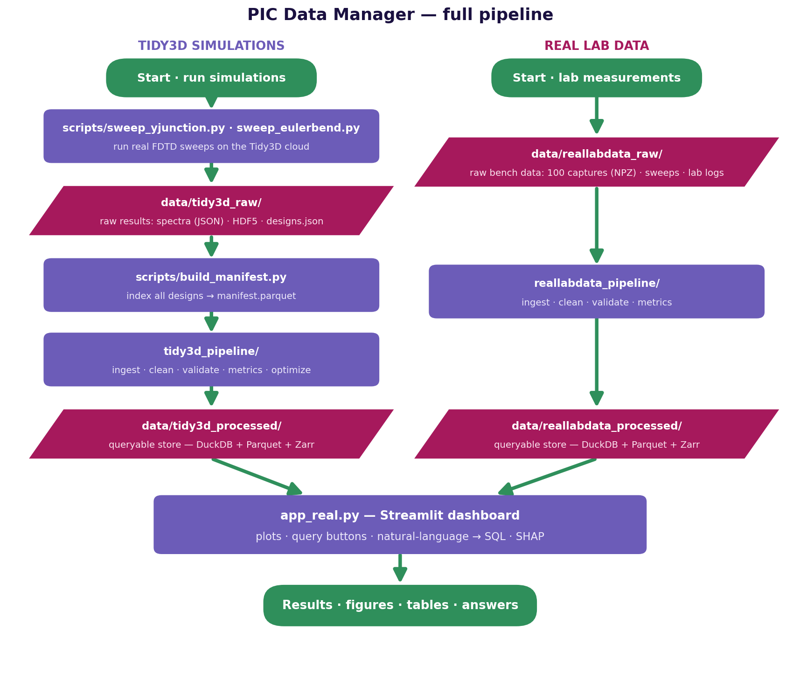
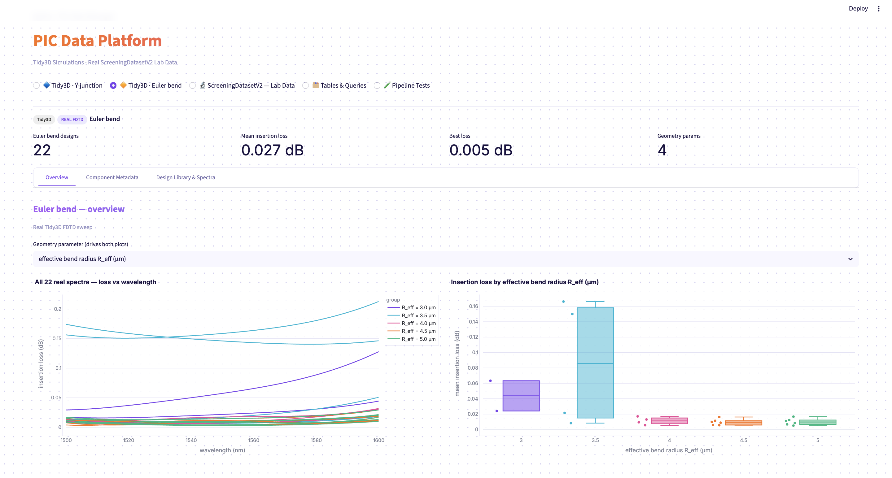
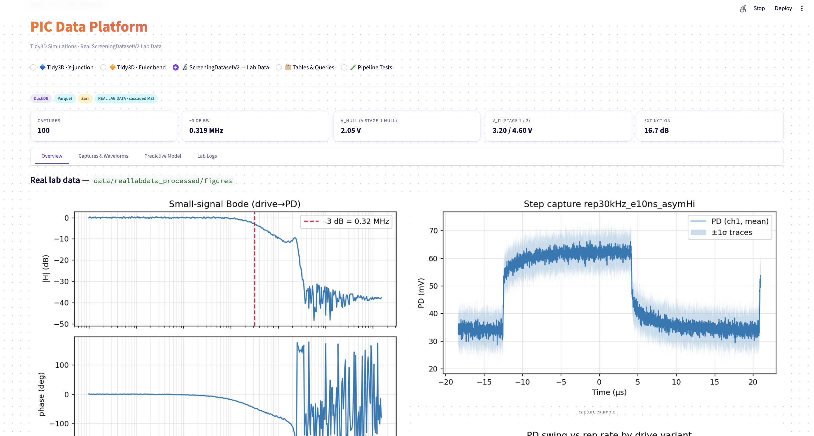
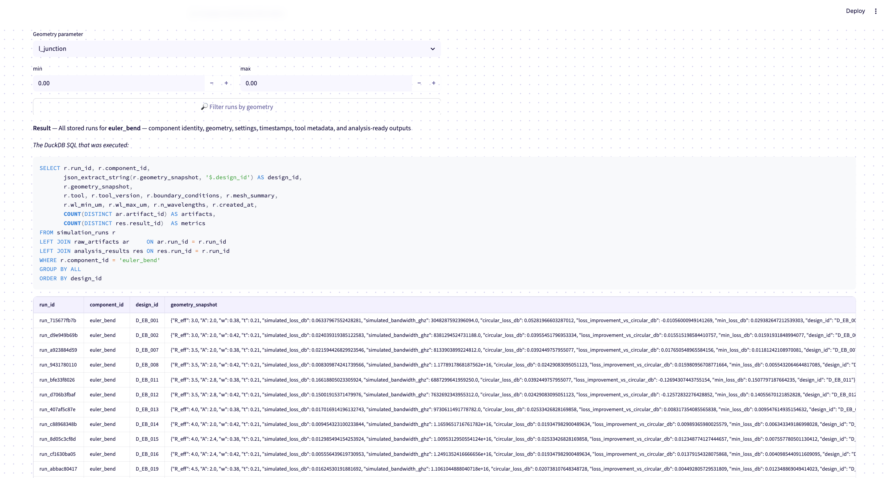

A reproducible data platform for photonic-integrated-circuit (PIC) development,
covering two **real** datasets end to end:

- **Tidy3D simulations** — 53 real FDTD designs (31 Y-junctions, 22 Euler bends)
  swept on the Tidy3D cloud, with full provenance.
- **Real lab data** — a cascaded Mach–Zehnder modulator characterization
  (static V_DC sweep, small-signal Bode, 100 step-pulse captures, operator lab logs).

Both flow through the same storage stack — **DuckDB** (metadata, provenance,
metrics, SQL queries) + **Parquet** (tabular arrays) + **Zarr** (N-D arrays) —
into an interactive Streamlit dashboard with one-click + natural-language querying,
RandomForest + SHAP modeling on the lab data, and a geometry-optimization loop.
No synthetic data, no SQLite.



## Repository structure

```
pic-data-manager/
├── tidy3d_pipeline/            # simulation pipeline: models · store · ingest · analysis · optimize · cli
├── reallabdata_pipeline/       # lab-data pipeline:  models · store · ingest · analysis · cli
├── scripts/
│   ├── sweep_yjunction.py      # run real FDTD sweeps on the Tidy3D cloud (costs FlexCredits)
│   ├── sweep_eulerbend.py      # each combo also runs a circular-bend baseline (2 jobs/combo)
│   └── build_manifest.py       # designs.json → data/tidy3d_raw/manifest.parquet
├── data/
│   ├── tidy3d_raw/             # RAW sim results: spectra (JSON) + manifest (Parquet)   [committed]
│   ├── reallabdata_raw/        # RAW lab dataset: captures (NPZ), sweeps, lab logs      [committed]
│   ├── tidy3d_processed/       # store: tidy3d.duckdb + arrays/*.parquet + fields/*.zarr [generated]
│   └── reallabdata_processed/  # store: reallabdata.duckdb + tables + waveforms/*.zarr   [generated]
├── notebooks/                  # interactive Tidy3D prototypes + raw HDF5 outputs
├── app_real.py                 # the Streamlit dashboard
├── dashboard_data.py           # headless data/analytics layer (no Streamlit; unit-testable)
├── tests/                      # pytest suites for both pipelines + metadata validation
├── technical_report.pdf        # architecture, schema, ingestion flow, results, tradeoffs
└── pipeline_flowchart.png      # the flow chart above
```

## Setup

```bash
git clone git@github.com:emefendy/pic-data-manager.git
cd pic-data-manager
pip install -r requirements.txt
```

**Dependencies** (`requirements.txt`): `pandas`, `numpy`, `scipy`, `pydantic` —
core; `duckdb`, `pyarrow`, `zarr`, `h5py` — storage; `scikit-learn`, `shap`,
`statsmodels` — modeling/attribution; `streamlit`, `plotly` — dashboard;
`anthropic` — natural-language → SQL queries (optional; needs `ANTHROPIC_API_KEY`);
`tidy3d`, `photonforge`, `gdstk` — only needed to run **new** FDTD sweeps
(requires a Flexcompute account + FlexCredits); `jupyterlab` — notebooks.

## Run the demo

One command — ingestion, analysis, and the dashboard:

```bash
streamlit run app_real.py    # builds both stores automatically on first launch
```

Both processed stores are built **once, automatically, on first launch** (a no-op
afterwards). To force a rebuild, delete `data/tidy3d_processed/` /
`data/reallabdata_processed/` and relaunch. The lab store builds from the in-repo
raw dataset (`data/reallabdata_raw/`; override with `SCREENING_DATASET`).

Query examples from the CLI:

```bash
python -m tidy3d_pipeline.cli summary
python -m tidy3d_pipeline.cli query --component y_junction
python -m tidy3d_pipeline.cli query --metric insertion_loss_mean
python -m tidy3d_pipeline.cli filter --geom l_junction --min 1.0 --max 2.0
python -m reallabdata_pipeline.cli captures --vlbl sym10 --rep 300000
```

## The dashboard

`streamlit run app_real.py` opens at `http://localhost:8501` (forced light theme
via `.streamlit/config.toml`). Five views, picked at the top:

**🔷 Tidy3D · Y-junction** and **🔶 Tidy3D · Euler bend** — the real FDTD designs
from the Parquet manifest, one view per component family:

- **Overview** — every real spectrum grouped by a swept geometry parameter
  (constants are excluded from the dropdown), beside the loss distribution that
  parameter creates (e.g. `l_junction` 1.5 → 2.0 µm drops loss ~0.55 dB).
- **Component Metadata** — the minimal component record from the `components`
  table: name, function, geometry (swept + fixed), material/platform assumptions,
  expected performance metrics, provenance. Verified against the manifest by tests.
- **Design Library & Spectra** — per-design spectrum viewer; the selected design
  is highlighted in the design table below.

**🔬 ScreeningDatasetV2 — Lab Data** — the cascaded-MZI characterization, served
from the `reallabdata_pipeline` DuckDB+Parquet+Zarr store:

- **Overview** — the pipeline's batch figures, then a **two-stage fringe
  decomposition**: a multi-start least-squares fit of
  P(V) = P0 + A·cos²(π(V−Vc1)/2Vπ1)·cos²(π(V−Vc2)/2Vπ2) to the static sweep
  (R² = 0.99997), recovering per-stage V_π (3.20 / 4.60 V) and nulls — a single
  V_π/V_null is not a device property on a two-stage cascade.
- **Captures & Waveforms** — per-capture PD trace (mean ±1σ) read from Zarr,
  with the selected capture highlighted in the filterable records table below.
- **Predictive Model** — cross-validated RandomForest predicting PD swing from
  drive parameters (R² ≈ 0.998) with built-in anomaly flagging (captures whose
  residual vs their out-of-fold prediction is ≥ 2σ — unusual *for their settings*,
  cross-referenced against the thermal-drift lab log), plus a **TreeSHAP**
  per-capture attribution view. (No ML on the simulations: FDTD is deterministic,
  so residuals there would measure surrogate-model error, not bad runs.)
- **Lab Logs** — the operator notes (the RAG seam).

**🗂 Tables & Queries** — the data-engineering view:

- **Query Tidy3D** — one-click query buttons that display the exact DuckDB SQL they
  execute (all stored runs with full provenance — identity, geometry, settings,
  timestamps, tool metadata, output counts · performance metrics · compare variants
  by metric · filter runs by geometry) beside a **natural-language query box**
  (Claude → DuckDB SQL, read-only).
- **Query lab data** — the same pattern for the lab store (all captures · filter
  by rep rate / drive variant) + its own NL query box.
- **Browse Tidy3D / Browse lab data** — every DuckDB table, previewable.
- **Pipeline figures** — the batch comparison figures written during the store build.

**🧪 Pipeline Tests** — live known-answer validation with code, expected, and
actual shown for each check: synthetic inputs through the real analysis functions
(unity transmission → 0 dB, cos² fringe → V_π recovered, single-pole → −45° at the
corner, ideal step → 80 ns rise), real end-to-end checks (raw spectrum JSON and
raw FRA .npz re-analyzed and compared to the stored metrics), ingestion
completeness (53 designs → 53 runs; 102 measurements ↔ 102 artifacts), metadata-
vs-manifest consistency, and SHA-256 re-verification of every checksummed artifact.

## How it maps to the rubric

| Task | Where |
|---|---|
| 1 — data model | `tidy3d_pipeline/models.py` (5 Pydantic entities) |
| 1 — storage | `tidy3d_pipeline/store.py` (DuckDB + Parquet + Zarr) |
| 1 — queries | `runs_for_component`, `metrics`, `compare_variants`/`compare_runs`, `filter_runs_by_geometry` |
| 1 — tests | `tests/` (analysis known-answers, ingest round-trip + idempotency, real-data integration, metadata validation) |
| 2 — Tidy3D adapter | `tidy3d_pipeline/ingest.py` (`ingest_tidy3d_design`, `ingest_tidy3d_hdf5`, `ingest_field_map_hdf5`) + real runs in `scripts/sweep_*.py` |
| 2 — provenance store | `SimulationRun` (tool/version/geometry/settings/timestamp) + checksummed `RawArtifact` (repo-relative paths) |
| 3 — two components | `tidy3d_pipeline/components.py` (Y-junction, Euler bend) — metadata records validated against the manifest |
| 3 — comparison | variant box plots in the dashboard + `figures/component_comparison.png`, `variant_comparison.png`; Euler bends carry a built-in circular-bend baseline |
| 4 — one command + report | `streamlit run app_real.py` (auto-builds both stores), `technical_report.pdf` |
| Stretch — optimization | `tidy3d_pipeline/optimize.py` → `optimization_progress.png` (l_junction = 2.0 µm, −0.54 dB) |

## Expected outputs

`data/tidy3d_processed/` — `tidy3d.duckdb` (2 components, 53 simulation runs,
212 analysis results, 31 optimization records), 53 Parquet spectra, 1 Zarr |E|²
field map (475×308 @ 1.55 µm), and `figures/` + `summary_table.csv`.

`data/reallabdata_processed/` — `reallabdata.duckdb` (102 measurements, 605
results, 5 lab logs), Parquet tables, 100 Zarr waveform cubes, and `figures/` +
`device_metrics.csv` / `capture_features.csv`.

Headline real-data results:

| Result | Value |
|---|---|
| Y-junction insertion loss (mean / best of 31 designs) | 0.465 dB / 0.155 dB |
| Euler bend insertion loss (mean / best of 22 designs) | 0.027 dB / 0.005 dB |
| Optimization (best `l_junction` = 2.0 µm) | **−0.54 dB** vs baseline |
| Lab device −3 dB bandwidth | 0.319 MHz (thermal-limited; electronics are ≥150 MHz) |
| Lab fringe (two-stage fit, R² = 0.99997) | V_π = 3.20 / 4.60 V per stage · global null 2.05 V · extinction 16.7 dB |

## Tests

```bash
pytest tests/ -q
```

Covers: analysis known-answer checks (unity → 0 dB, half power → 3.01 dB),
nonphysical-input rejection, model validation, ingestion round-trip and
idempotency, real-dataset integration, optimization records, and component
metadata vs the actual sweep manifest. The dashboard's **🧪 Pipeline Tests** view
runs the same style of checks live, including raw-file → stored-metric
end-to-end verification and artifact checksum re-validation.

## Notes

- **No synthetic data, no SQLite.** Only real FDTD designs (`designer in
  ('sweep','simulation_import')`) are ingested, via the Parquet manifest;
  everything reads Parquet + DuckDB + Zarr.
- **Modeling:** RandomForest + SHAP on the lab captures only (the datasets are
  tiny — 31/22/100 rows — so no neural nets, and no ML on deterministic
  simulation results).
- The pure data + analytics layer lives in `dashboard_data.py` (no Streamlit),
  so it can be unit-tested headless.
- Artifact paths in the stores are **repo-relative**, so the committed DuckDB
  files resolve on any checkout.
- Fixed a unit bug in the legacy bandwidth helper (`scripts/sweep_*.py`):
  `td.C_0/λ` is Hz, so GHz = `/1e9` (was `×1e3`, giving the bogus `1.25e16`).
  `tidy3d_pipeline` reports bandwidth in nm.

## Documentation

- [`technical_report.pdf`](technical_report.pdf) — architecture, flow charts, schema,
  ingestion flow, analysis results, design tradeoffs, next steps.

## Data sources & acknowledgments

The Y-junction design is adapted from the Tidy3D example library (Zhang et al.,
*Opt. Express* **21**, 1310 (2013)); the Euler bend is a public SOI reference
design. FDTD runs were executed on Tidy3D (Flexcompute). The lab dataset is the
QuEra ScreeningDatasetV2 cascaded-MZI characterization. AI coding tools (Claude)
were used in building this project, as permitted by the challenge.

## Screenshots






